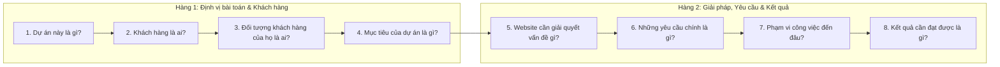
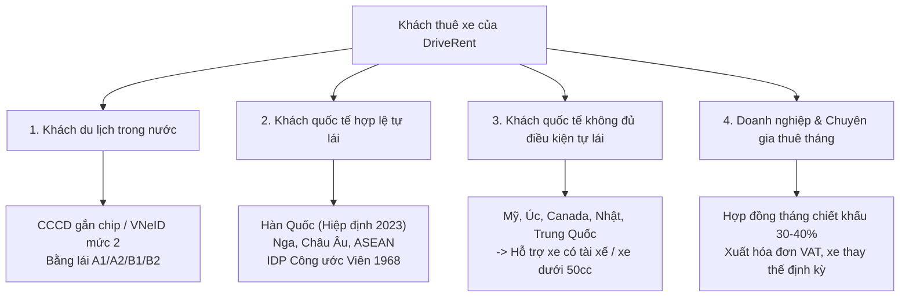
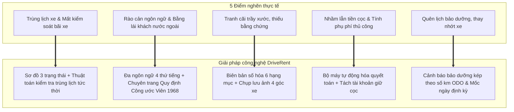

# TÀI LIỆU TÓM TẮT DỰ ÁN (PROJECT BRIEF)
## HỆ THỐNG QUẢN LÝ DỊCH VỤ CHO THUÊ XE MÁY, Ô TÔ & XE ĐIỆN TỰ LÁI DRIVERENT

| Thông tin dự án | Chi tiết đặc tả |
| :--- | :--- |
| **Tên dự án:** | **DriveRent** - Nền tảng Đặt xe & Quản lý Cho thuê Xe máy, Ô tô & Xe điện Tự lái Thông minh |
| **Mã dự án:** | `DRV-RENT-2026` |
| **Phiên bản:** | `2.5 (Cập nhật Toàn diện)` |
| **Lĩnh vực / Ngành:** | Vận tải du lịch, OTA (Online Travel Agency) & Chuyển đổi số Doanh nghiệp |
| **Kho lưu trữ mã nguồn:** | [GitHub Repository - QuanLyDatXe_DriveRent](https://github.com/DinhTuanHai-TBD/QuanLyDatXe_DriveRent) |
| **Công nghệ cốt lõi:** | React 18, TypeScript, Tailwind CSS, Lucide Icons, Python Docx, Vite |

---

> [!NOTE]
> **Bản tóm tắt dự án (Project Brief)** là tài liệu định hình bài toán kinh doanh, phạm vi giải pháp và kết quả bàn giao theo chuẩn mực **8 câu hỏi cốt lõi**. Tài liệu phản ánh trọn vẹn toàn bộ các tính năng và kiến trúc mới nhất của hệ thống DriveRent sau các đợt nâng cấp.

---

## 1. Dự án này là gì?

**DriveRent** là **Nền tảng lai (Hybrid Platform)** tích hợp hai phân hệ chuyên biệt trên cùng một hệ thống mã nguồn:
1. **Cổng Khách hàng (Online Booking Portal):** Kênh đặt xe tự lái trực tuyến hướng tới khách du lịch trong nước và quốc tế, mang phong cách thiết kế kính mờ **Liquid Glass (Glassmorphism)** sang trọng, phông nền gara studio vòm đèn LED công nghệ cao.
2. **Hệ thống Quản trị Nội bộ (Back-office ERP / CRM / FMS / RMS):** Hệ thống điều hành toàn diện dành cho chủ gara và đội ngũ nhân sự, quản lý chặt chẽ vòng đời vận hành của đội xe, hợp đồng, biên bản giao nhận và quyết toán tài chính.

### Điểm nhấn nhận diện và công nghệ:
* **Bộ sưu tập 16 mẫu xe thực tế chất lượng cao:**
  * **6 Xe điện VinFast:** VF 3 (Mini SUV), VF 5 Plus, VF 6 Plus, VF 7 Plus, VF 8 Plus, VF 9 Plus (SUV 7 chỗ hạng sang).
  * **6 Ô tô máy xăng:** Toyota Vios 1.5G, Mitsubishi Xpander 1.5 AT, Mazda 3 Premium, Kia Carnival 2.2D Signature, Ford Everest Titanium 4x4, Hyundai Accent 1.4 AT.
  * **4 Xe máy du lịch:** Honda Vision 110cc, Honda Air Blade 160cc, Honda SH Mode 125cc, Honda Wave Alpha 110cc.
* **Giao diện Kính mờ (Liquid Glass) & Taskbar thông minh:** Header đổi hiệu ứng mờ cao cấp khi cuộn trang, nút **"Đăng nhập"** độc lập nằm ngay sau nút **"Xem xe & Đặt cọc"**, dẫn thẳng vào giao diện toàn màn hình `LoginView` với trải nghiệm mượt mà.
* **Hỗ trợ song song 2 gói thuê:** **Thuê ngày (24h)** và **Thuê tháng (chiết khấu 30-40%)**, tự động cập nhật bảng giá niêm yết trên toàn bộ thẻ xe.
* **Popup xem chi tiết xe chuẩn Mioto:** Xem gallery ảnh lớn, thông số chi tiết, trang bị tiện nghi, điều kiện bằng lái và tạm tính chi phí trong 1 thao tác bấm.
* **Hệ thống Đa ngôn ngữ (i18n):** Hỗ trợ 4 ngôn ngữ linh hoạt: **Tiếng Việt**, **Tiếng Anh (English)**, **Tiếng Nga (Русский)** và **Tiếng Hàn (한국어)**.

---

## 2. Khách hàng là ai?

Khách hàng trực tiếp của nền tảng DriveRent là **các cơ sở, doanh nghiệp và chuỗi cửa hàng kinh doanh dịch vụ cho thuê xe tự lái** (quy mô từ 15 đến hơn 100 đầu xe) tại các thành phố du lịch biển và trung tâm kinh tế trọng điểm như: **Nha Trang, Cam Ranh, Đà Nẵng, Phú Quốc, Đà Lạt, Quy Nhơn, Vũng Tàu, TP. Hồ Chí Minh và Hà Nội**.

Trong nội bộ doanh nghiệp, hệ thống phục vụ trực tiếp 3 nhóm đối tượng nhân sự:
* **Chủ cơ sở / Ban Giám đốc điều hành (Admin):** Cần báo cáo tài chính thời gian thực, doanh thu theo ngày/tháng, kiểm soát dòng tiền cọc đang nắm giữ, tỷ lệ lấp đầy đội xe và chỉ số xe bảo dưỡng.
* **Nhân viên Lễ tân / Điều phối kinh doanh (Staff):** Cần tra cứu nhanh xe trống theo khoảng ngày giờ, tạo hợp đồng điện tử 4 bước trong 2 phút, thực hiện biên bản bàn giao - thu hồi xe có ảnh chụp thực tế và thanh lý quyết toán trừ cọc chuẩn xác.
* **Kỹ thuật viên / Quản lý xưởng (Technician):** Cần theo dõi chỉ số km ODO thực tế, cảnh báo xe đến hạn thay nhớt, kiểm định an toàn pin, hạn đăng kiểm và bảo hiểm phương tiện.

---

## 3. Đối tượng khách hàng của họ là ai?

Khách thuê xe (End-users) của nhà xe bao gồm 4 phân khúc khách hàng chiến lược:

1. **Khách du lịch trong nước (Cá nhân, gia đình, bạn trẻ):**
   * Nhu cầu thuê xe máy hoặc ô tô 5-7 chỗ khám phá các điểm du lịch từ 1 đến 5 ngày.
   * Yêu cầu đặt cọc nhanh qua quét mã QR, thủ tục nhận xe đơn giản qua Căn cước công dân gắn chip hoặc tài khoản VNeID định danh mức 2.
2. **Khách du lịch quốc tế hợp lệ tự lái (Hàn Quốc, Nga, Châu Âu, ASEAN):**
   * Nhóm du khách sở hữu Giấy phép lái xe quốc tế (IDP) cấp theo **Công ước Viên 1968** (trong đó khách Hàn Quốc được công nhận theo Hiệp định song phương Việt - Hàn 2023; khách Nga chiếm tỷ trọng du khách vượt trội tại Nha Trang và Phú Quốc).
   * Yêu cầu xem thông tin, quy định pháp lý và hợp đồng bằng chính ngôn ngữ mẹ đẻ (Tiếng Nga, Tiếng Hàn, Tiếng Anh).
3. **Khách quốc tế không đủ điều kiện tự lái theo luật Việt Nam (Mỹ, Úc, Canada, Nhật Bản, New Zealand, Trung Quốc...):**
   * Do các quốc gia này chỉ cấp IDP theo Công ước Geneva 1949 hoặc chưa gia nhập Công ước Viên 1968 nên không được phép tự lái xe tại Việt Nam.
   * Hệ thống chủ động cảnh báo pháp lý và định tuyến hướng dẫn khách lựa chọn: **Thuê xe kèm tài xế riêng (Chauffeur)** hoặc **Thuê xe máy điện / xe dưới 50cc** không yêu cầu bằng lái.
4. **Doanh nghiệp, chuyên gia FDI & Khách công tác thuê theo tháng:**
   * Cần thuê xe dài hạn từ 1 đến 12 tháng (VinFast VF 8, VF 9, Carnival, Mazda 3) với mức giá chiết khấu 30-40%, dịch vụ bảo dưỡng định kỳ trọn gói và cam kết xe thay thế tương đương.

---

## 4. Mục tiêu của dự án là gì?

Hệ thống DriveRent hướng tới 5 mục tiêu chiến lược định lượng:

| STT | Mục tiêu chiến lược | Ý nghĩa thực tiễn |
| :---: | :--- | :--- |
| **01** | **Số hóa 100% quy trình vận hành** | Khai tử sổ ghi tay, bảng tính Excel phân tán; đồng bộ hóa dữ liệu từ lúc khách giữ chỗ online đến khi hoàn trả xe và thanh lý cọc. |
| **02** | **Tối ưu doanh thu với gói Ngày & Tháng** | Cung cấp bảng giá linh hoạt theo chu kỳ 24h và theo tháng (chiết khấu 30-40%), mở rộng tệp khách thuê dài hạn ổn định doanh thu. |
| **03** | **Quốc tế hóa dịch vụ & Tuân thủ pháp lý** | Phá vỡ rào cản ngôn ngữ với 4 thứ tiếng; thực hiện nghiêm chỉnh Luật Giao thông Đường bộ và Thông tư 29/2015/TT-BGTVT về IDP Công ước Viên 1968. |
| **04** | **Bảo vệ tài sản & Minh bạch tiền cọc** | Tách bạch 100% tiền cọc khỏi doanh thu hoạt động; chuẩn hóa biên bản giao nhận 6 hạng mục kèm ảnh chụp hiện trạng 4 góc để triệt tiêu tranh chấp. |
| **05** | **Cắt giảm 85% thời gian thủ tục** | Rút ngắn quy trình tạo hợp đồng và bàn giao nhận xe tại quầy từ 15-20 phút xuống chỉ còn 2-3 phút. |

---

## 5. Website cần giải quyết vấn đề gì?

Hệ thống loại bỏ hoàn toàn 5 điểm nghẽn nghiêm trọng nhất trong vận hành nhà xe truyền thống:

1. **Xung đột trùng lịch & Không nắm bắt được tình trạng xe:**
   * *Giải pháp:* Thuật toán `checkVehicleAvailability` tự động khóa các xe đã có lịch trong khoảng ngày giờ yêu cầu; Sơ đồ trực quan phân định 3 màu rõ rệt: **🟢 Sẵn sàng**, **🔵 Đang thuê**, **🟠 Đang bảo dưỡng**.
2. **Bất đồng ngôn ngữ & Rủi ro pháp lý với du khách nước ngoài:**
   * *Giải pháp:* Giao diện chuyển đổi tức thời 4 ngôn ngữ (Việt, Anh, Nga, Hàn); Hệ thống thông báo rõ ràng điều kiện bằng lái hợp lệ, tránh rủi ro xe bị cảnh sát giao thông tạm giữ hoặc bị phạt nặng.
3. **Tranh chấp trầy xước, phụ kiện hư hại khi khách trả xe:**
   * *Giải pháp:* Quy trình kiểm tra 6 hạng mục (Thân vỏ dàn áo, Lốp xe, Đèn còi xi-nhan, Gương chiếu hậu, Nhiên liệu/pin, Phụ kiện đi kèm) với ảnh chụp hiện trạng thực tế lúc xuất bãi làm bằng chứng không thể chối cãi.
4. **Nhầm lẫn tiền cọc vào doanh thu & Tính sai phụ phí trễ giờ:**
   * *Giải pháp:* Bộ công cụ tính toán tự động: chuẩn hóa phụ phí theo giờ, phí hao hụt xăng/pin, phí đền bù trầy xước; tự động khấu trừ vào tiền cọc ban đầu và in phiếu hoàn trả minh bạch.
5. **Phương tiện hỏng hóc giữa đường do quên bảo dưỡng:**
   * *Giải pháp:* Thuật toán cảnh báo kép: tự động cộng dồn km ODO sau mỗi hợp đồng và so sánh với chu kỳ thay nhớt/bảo dưỡng định kỳ để thông báo cho kỹ thuật viên.

---

## 6. Những yêu cầu chính là gì?

### 6.1. Yêu cầu Cổng Khách hàng (Customer Front-end)
* **Giao diện Kính mờ Liquid Glass & Taskbar thông minh:** Card xe trong suốt mờ ảo, viền phản quang hiện đại, thanh taskbar tự đổi màu mờ khi cuộn trang; nút **"Đăng nhập"** độc lập sau **"Xem xe & Đặt cọc"** mở toàn màn hình `LoginView`.
* **Bộ sưu tập 16 xe thực tế đa phân khúc:** Phân chia 3 tab rõ ràng (Xe điện VinFast, Ô tô máy xăng, Xe máy du lịch) với ảnh chụp góc nghiêng sắc nét chuẩn showroom.
* **Bộ chuyển đổi linh hoạt Thuê ngày / Thuê tháng:** Hộp nút lựa chọn được đóng khung nổi bật, tự động áp dụng giá thuê ngày hoặc giá thuê tháng chiết khấu cho toàn bộ danh mục xe.
* **Popup chi tiết xe chuẩn Mioto:** Nhấp vào ảnh hoặc nút thuê xe hiển thị popup gồm: Bộ sưu tập ảnh thực tế, thông số mã lực/tiêu hao, danh mục tiện nghi (bản đồ, camera lùi, ghế da, túi khí), quy định bằng lái và bảng tạm tính tổng cước.
* **Chuyên trang Quy định Bằng lái xe Việt Nam & Quốc tế:** Hướng dẫn chi tiết quy định bằng lái cho khách Việt Nam, khách quốc tế có IDP Công ước Viên 1968 và phương án cho khách không thuộc Công ước Viên.
* **Hệ thống Đa ngôn ngữ (i18n):** Bộ chuyển đổi cờ ngôn ngữ trên Header (Tiếng Việt, Tiếng Anh, Tiếng Nga, Tiếng Hàn).
* **Quy trình Đặt cọc giữ xe 10 phút:** Đồng hồ đếm ngược 10 phút, mã QR thanh toán cọc tự động tạo theo thông tin ngân hàng và mã đặt xe.

### 6.2. Yêu cầu Hệ thống Quản trị Nội bộ (Admin Back-office)
* **Dashboard Giám sát Điều hành:** Thống kê xe sẵn sàng, xe đang cho thuê, xe bảo dưỡng, tổng hợp doanh thu và danh sách hợp đồng đến hạn trả trong ngày.
* **FMS Quản lý Đội xe trực quan:** Xem theo lưới thẻ màu hoặc bảng danh sách; cập nhật ODO, ngày bảo dưỡng gần nhất, hạn đăng kiểm và hạn bảo hiểm.
* **RMS Quản lý Hợp đồng & Bàn giao:**
  * Wizard 4 bước tạo hợp đồng: Chọn xe & thời gian -> Thông tin khách -> Chụp ảnh CCCD/GPLX -> Tiền cọc & Phụ phí.
  * Biên bản bàn giao 6 hạng mục kèm ảnh chụp lúc giao và lúc thu hồi xe.
  * In Hợp đồng chuẩn A4: Văn bản pháp lý hoàn chỉnh có Quốc hiệu, Tiêu ngữ, điều khoản bảo vệ tài sản và chỗ ký tên của hai bên.
* **CRM Quản trị Hồ sơ Khách hàng:** Lưu trữ thông tin cá nhân, ảnh CCCD/Passport, bằng lái, lịch sử các lần thuê và điểm uy tín tín nhiệm.
* **Mini ERP & Quản lý Bảo dưỡng:** Sổ theo dõi lịch sử thay nhớt, kiểm định phanh/pin, phụ tùng thay thế và hạch toán chi phí sửa chữa.

---

## 7. Phạm vi công việc đến đâu?

### 7.1. Trong phạm vi thực hiện (Đã hoàn thiện 100%)
* [x] Xây dựng hoàn chỉnh **21 tính năng nghiệp vụ** trên cả 2 phân hệ Khách hàng và Quản trị viên.
* [x] Thiết kế giao diện **Responsive 100%** tối ưu mượt mà trên Điện thoại, Máy tính bảng và Máy tính bàn.
* [x] Xây dựng bộ dữ liệu mẫu thực tế của **16 mẫu xe** (VinFast VF 3 - VF 9, Vios, Xpander, Carnival, Everest, Vision, Air Blade, SH Mode, Wave Alpha).
* [x] Hoàn thiện trọn vẹn luồng nghiệp vụ: **Duyệt xe online -> Đặt cọc giữ chỗ 10 phút -> Bàn giao xe (ảnh chụp) -> Thu hồi xe (kiểm định 6 mục) -> Quyết toán cọc -> Cảnh báo bảo dưỡng**.
* [x] Tích hợp chuyên trang **Quy định Bằng lái xe Việt Nam & Quốc tế** chuẩn Công ước Viên 1968.
* [x] Tích hợp kiến trúc **Đa ngôn ngữ** (Việt - Anh - Nga - Hàn).
* [x] Đảm bảo chất lượng mã nguồn TypeScript, vượt qua kiểm thử đóng gói (`npm run build`) thành công 100% và lưu trữ đồng bộ trên GitHub.

### 7.2. Ngoài phạm vi hiện tại (Định hướng phát triển Giai đoạn 2)
* [ ] Cổng thanh toán trực tiếp qua ngân hàng (VietQR / VNPay Webhook tự động bắt giao dịch thời gian thực).
* [ ] Tích hợp phần cứng IoT GPS trên xe để tự động truyền dữ liệu ODO km lăn bánh và vị trí xe về máy chủ.
* [ ] Công nghệ AI OCR quét và tự động điền thông tin từ ảnh chụp CCCD/Passport và Giấy phép lái xe.

---

## 8. Kết quả cần đạt được là gì?

### 8.1. Các sản phẩm bàn giao cụ thể
1. **Kho mã nguồn hoàn chỉnh (GitHub Repository):** Toàn bộ source code frontend React + TypeScript, cấu trúc module rõ ràng, clean code và không có lỗi linter.
2. **Hệ thống ứng dụng vận hành thực tế:** Web Portal cho khách hàng và Hệ thống quản trị nội bộ hoạt động mượt mà, tốc độ tải dưới 1.5 giây.
3. **Bộ tài liệu đặc tả dự án chuẩn mực:**
   * File văn bản Word: [DriveRent_Project_Brief.docx](file:///c:/Users/ASUS/source/repos/QuanLyDatXe_DriveRent/DriveRent_Project_Brief.docx) trình bày chuyên nghiệp, có bảng biểu, callout box và định dạng chuẩn in ấn.
   * File Markdown chi tiết: [DriveRent_Project_Brief.md](file:///c:/Users/ASUS/source/repos/QuanLyDatXe_DriveRent/DriveRent_Project_Brief.md) phục vụ lưu trữ tài liệu trực tiếp trên Git.

### 8.2. Bảng đối chiếu chỉ số hiệu quả kinh doanh & Vận hành (KPIs)

| Chỉ số đo lường hiệu quả | Trước khi áp dụng DriveRent | Sau khi áp dụng DriveRent | Mức độ cải thiện |
| :--- | :--- | :--- | :---: |
| **Thời gian làm thủ tục nhận/trả xe** | 15 - 20 phút / lượt khách | **2 - 3 phút / lượt khách** | **Giảm 85% thời gian** |
| **Tỷ lệ sai lệch & Nhầm lẫn tiền cọc** | Thường xuyên nhầm lẫn vào doanh thu | **Chính xác 100% (Tách biệt tài khoản cọc)** | **Triệt tiêu sai sót** |
| **Tỷ lệ tranh chấp hư hại xe lúc trả** | 30% - 40% hợp đồng phát sinh cự cãi | **0% (Nhờ biên bản 6 mục & ảnh chụp 4 góc)** | **Xóa bỏ tranh chấp** |
| **Tốc độ tra cứu tình trạng xe trống** | Mất 5 - 10 phút gọi điện, dò sổ sách | **Tức thì 1 giây qua bộ lọc thời gian thực** | **Nhanh gấp 300 lần** |
| **Khả năng phục vụ khách quốc tế** | Khó khăn do rào cản ngôn ngữ & luật lái xe | **Tối ưu vượt bậc (Đa ngôn ngữ & Chuẩn Công ước Viên)** | **Tăng 40% doanh thu khách ngoại** |
| **Tỷ lệ xe bỏ quên bảo dưỡng ODO** | 20% - 25% xe trễ hạn thay nhớt định kỳ | **0% (Hệ thống cảnh báo kép km & ngày)** | **Tăng 30% tuổi thọ xe** |

---
*Tài liệu được cập nhật và phê duyệt chính thức theo tiêu chuẩn quản lý dự án công nghệ vận tải du lịch.*