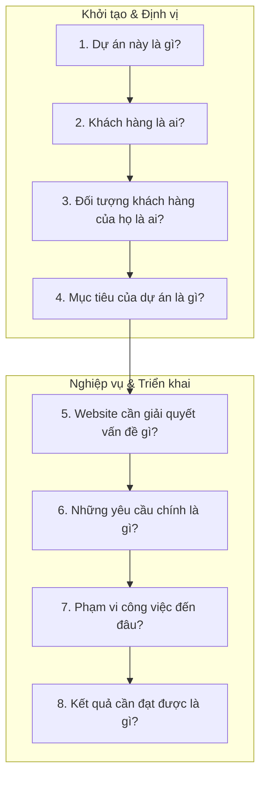

# TÀI LIỆU TÓM TẮT DỰ ÁN
## HỆ THỐNG QUẢN LÝ DỊCH VỤ CHO THUÊ XE MÁY & Ô TÔ TỰ LÁI DRIVERENT

* **Tên dự án:** DriveRent - Hệ thống Quản lý Cho thuê Xe máy & Ô tô Tự lái Thông minh
* **Mã dự án:** `DRV-RENT-2026`
* **Kho lưu trữ mã nguồn:** [https://github.com/DinhTuanHai-TBD/QuanLyDatXe_DriveRent](https://github.com/DinhTuanHai-TBD/QuanLyDatXe_DriveRent)
* **Phiên bản:** 1.0.0
* **Ngày cập nhật:** 13/10/2026

---

> [!NOTE]
> **Cấu trúc tài liệu:** Được xây dựng chuẩn theo phương pháp tiếp cận *"Hiểu đúng bài toán trước khi làm"* – trả lời đầy đủ và chi tiết 8 câu hỏi cốt lõi của một dự án công nghệ.



---

## 1. DỰ ÁN NÀY LÀ GÌ?

**DriveRent** là **Hệ thống phần mềm quản lý và vận hành dịch vụ cho thuê xe máy & ô tô tự lái toàn diện**, tích hợp đồng bộ 2 phân hệ cốt lõi trên một nền tảng duy nhất:

1. **Cổng Khách hàng:**
   * Website trực tuyến hiện đại dành cho du khách tìm kiếm, tham khảo thông số kỹ thuật, kiểm tra giá thuê theo giờ hoặc theo ngày và đặt cọc giữ chỗ trực tuyến.
   * Ứng dụng ngôn ngữ thiết kế kính mờ trong suốt cao cấp, hiệu ứng xe chạy vào bãi gara vòm đèn LED sống động, thanh điều hướng taskbar chuyển đổi trạng thái mượt mà theo vị trí cuộn trang.
2. **Hệ thống Quản trị & Điều hành Nội bộ:**
   * Bảng điều khiển dành riêng cho chủ nhà xe, nhân viên lễ tân, kế toán và đội ngũ thợ kỹ thuật.
   * Giám sát đội xe trực quan theo thời gian thực, số hóa quy trình lập hợp đồng trong 2 phút, quản lý biên bản bàn giao và thu hồi xe kèm ảnh chụp hiện trạng thực tế, tự động quyết toán phân định tiền cọc và quản lý lịch bảo trì, nhắc thay nhớt định kỳ.

---

## 2. KHÁCH HÀNG LÀ AI?

Khách hàng trực tiếp của dự án là:

* **Chủ doanh nghiệp, chuỗi cửa hàng và cơ sở kinh doanh dịch vụ cho thuê phương tiện tự lái:**
  * Quy mô từ vừa đến nhỏ, sở hữu từ 15 đến hơn 80 xe hỗn hợp cả ô tô và xe máy.
  * Tập trung tại các thành phố du lịch trọng điểm của Việt Nam như Đà Nẵng, Nha Trang, Phú Quốc, Đà Lạt, Quy Nhơn, Vũng Tàu, Hà Nội, TP.HCM,...
* **Đội ngũ vận hành nội bộ của nhà xe:**
  * **Quản lý, Chủ cửa hàng:** Cần giám sát tổng thể tình hình kinh doanh, doanh thu, dòng tiền cọc đang nắm giữ và hiệu suất khai thác đội xe mọi lúc mọi nơi.
  * **Nhân viên Lễ tân, Tiếp đón khách:** Cần thao tác tra cứu xe trống nhanh chóng, làm thủ tục hợp đồng, bàn giao xe cho khách mà không tốn thời gian ghi chép thủ công.
  * **Kỹ thuật viên, Thợ bảo dưỡng:** Cần theo dõi số km lăn bánh của từng xe để thay dầu nhớt, kiểm tra má phanh, lốp xe đúng định kỳ.

---

## 3. ĐỐI TƯỢNG KHÁCH HÀNG CỦA HỌ LÀ AI?

Đối tượng khách hàng cuối mà các nhà xe phục vụ bao gồm:

* **Khách du lịch cá nhân & Nhóm bạn trẻ:**
  * Nhu cầu thuê xe máy tay ga, xe số hoặc ô tô cỡ nhỏ 4 chỗ để tự do khám phá danh lam thắng cảnh và ẩm thực địa phương.
  * Ưa chuộng công nghệ: Thích xem ảnh thật của xe, bảng giá minh bạch, đặt cọc giữ xe nhanh qua mã QR chuyển khoản ngân hàng.
* **Khách du lịch gia đình:**
  * Nhu cầu thuê ô tô 7 chỗ như Mitsubishi Xpander, Toyota Innova rộng rãi, an toàn, có điều hòa tốt và khoang hành lý lớn.
  * Đòi hỏi cao về tính an toàn, bảo dưỡng định kỳ và hợp đồng pháp lý minh bạch.
* **Chuyên gia & Khách công tác ngắn ngày:**
  * Cần thuê xe tự lái theo ngày hoặc theo giờ để di chuyển giữa sân bay, khách sạn và các địa điểm làm việc.
* **Người dân địa phương:**
  * Có nhu cầu thuê xe phục vụ đám cưới, về quê dịp lễ tết hoặc phương tiện cá nhân đang bảo hành, sửa chữa.

---

## 4. MỤC TIÊU CỦA DỰ ÁN LÀ GÌ?

Dự án DriveRent hướng tới các mục tiêu chiến lược:

1. **Số hóa 100% quy trình vận hành:** Xóa bỏ hoàn toàn việc ghi chép sổ sách thủ công, bảng tính rời rạc hoặc trao đổi qua tin nhắn dễ thất lạc.
2. **Rút ngắn thời gian xử lý thủ tục:** Giảm thời gian lập hợp đồng và bàn giao nhận xe từ 15–20 phút xuống còn **dưới 2–3 phút** nhờ quy trình 4 bước và biên bản số hóa.
3. **Minh bạch tài chính & Bảo vệ tài sản:** Phân tách rõ ràng giữa tiền cọc cách ly và doanh thu dịch vụ thực tế; lưu trữ ảnh chụp hiện trạng xe lúc giao và nhận để loại trừ hoàn toàn nguy cơ tranh chấp trầy xước.
4. **Nâng cao hiệu suất khai thác xe:** Giám sát trạng thái đội xe theo thời gian thực gồm Sẵn sàng, Đang thuê, Bảo dưỡng để hạn chế tối đa tình trạng trùng lịch cho thuê hoặc để xe trống lãng phí.
5. **Duy trì an toàn & Kéo dài tuổi thọ phương tiện:** Cảnh báo tự động lịch thay dầu nhớt và kiểm tra định kỳ theo định mức km lăn bánh và số ngày thực tế.
6. **Đột phá trải nghiệm khách hàng:** Cung cấp giao diện website phong cách kính mờ trong suốt sang trọng, thao tác mượt mà, định vị thương hiệu nhà xe đẳng cấp trong mắt khách du lịch.

---

## 5. WEBSITE CẦN GIẢI QUYẾT VẤN ĐỀ GÌ?

Website DriveRent được xây dựng để giải quyết triệt để **4 khó khăn, bất cập lớn nhất** trong ngành cho thuê xe:

### 5.1. Vấn đề 1: Mất kiểm soát trạng thái phương tiện theo thời gian thực
* *Thực trạng:* Quản lý bằng sổ tay hoặc trí nhớ khiến nhân viên không biết chính xác xe nào đang đỗ tại bãi, xe nào đang cho thuê, xe nào sắp đến giờ trả và xe nào đang hỏng hóc.
* *Hậu quả:* Nhận cọc của khách nhưng không có xe giao dẫn đến trùng lịch, hoặc khách đến hỏi nhưng nhân viên tưởng hết xe nên từ chối.
* *Giải pháp DriveRent:* **Sơ đồ trạng thái xe trực quan** với 3 màu chuẩn nhận diện gồm Sẵn sàng (màu xanh lá), Đang thuê (màu xanh dương), Đang bảo dưỡng (màu cam), lọc xe trống theo ngày giờ nhận và trả chỉ trong 1 thao tác.

### 5.2. Vấn đề 2: Tranh chấp hư hỏng trầy xước & Thất lạc hồ sơ giấy tờ
* *Thực trạng:* Bàn giao xe chỉ nhìn bằng mắt thường, không chụp ảnh lưu trữ; giữ giấy tờ tùy thân gốc dễ làm thất lạc hoặc gây phiền toái cho khách.
* *Hậu quả:* Khi trả xe phát hiện vết móp méo, trầy xước mới, hai bên cãi vã vì không có bằng chứng đối chiếu. Khi có phạt nguội vi phạm giao thông, nhà xe không tìm lại được thông tin người lái.
* *Giải pháp DriveRent:* **Biên bản bàn giao và thu hồi số hóa** với danh mục kiểm tra 6 hạng mục, lưu trữ trực tiếp ảnh chụp 4 góc xe và ảnh chụp 2 mặt căn cước công dân, giấy phép lái xe gốc.

### 5.3. Vấn đề 3: Tính toán chi phí thủ công & Nhập nhằng tiền cọc
* *Thực trạng:* Khách thuê linh hoạt như trả trễ vài tiếng, thiếu vạch xăng, thuê thêm nón bảo hiểm, giao xe tận nơi. Tính nhẩm thủ công dễ sai lệch.
* *Hậu quả:* Kế toán nhầm lẫn tiền cọc của khách vào doanh thu, dẫn đến cãi cọ gay gắt lúc thanh lý hợp đồng và hoàn trả tiền cọc.
* *Giải pháp DriveRent:* **Quyết toán tự động & Phân định tiền cọc**. Tiền cọc được lưu trữ ở tài khoản ký quỹ riêng, hệ thống tự động bù trừ vào tiền thuê thực tế hoặc hoàn trả toàn bộ cọc qua chuyển khoản nhanh.

### 5.4. Vấn đề 4: Bỏ quên lịch thay nhớt và bảo dưỡng định kỳ
* *Thực trạng:* Xe cho thuê chạy cường độ cao liên tục, không ai nhớ xe nào đã chạy bao nhiêu km từ lần thay dầu gần nhất.
* *Hậu quả:* Động cơ xe máy bó máy, ô tô quá nhiệt hoặc mòn phanh gây nguy hiểm tính mạng cho du khách khi đi đường đèo dốc, chi phí đại tu tốn kém hàng chục triệu đồng.
* *Giải pháp DriveRent:* **Hệ thống cảnh báo bảo trì kép** tự động nhắc thay nhớt khi xe đạt mốc km quy định (mỗi 3.000 km với xe máy, mỗi 5.000 km với ô tô) hoặc chạm mốc ngày quy định.

---

## 6. NHỮNG YÊU CẦU CHÍNH LÀ GÌ?

### 6.1. Yêu cầu Phân hệ Khách hàng
* **Giao diện kính mờ trong suốt chuẩn mực:** Toàn bộ thẻ xe, khung lọc, bảng thông tin, cửa sổ thông báo đều sử dụng hiệu ứng kính mờ trong suốt, viền sáng bóng, đổ bóng mờ sang trọng phủ khắp toàn bộ trang web.
* **Thanh điều hướng cố định thông minh:** Cố định ở đầu màn hình khi cuộn trang; hiển thị dạng kính trong suốt nhìn thấu gara khi ở đầu trang và chuyển sang màu trắng thanh lịch khi cuộn xuống.
* **Phông nền phòng trưng bày gara vòm đèn LED:** Hình nền gara tràn viền toàn màn hình; hiệu ứng xe lăn bánh tự động vào tâm bãi đỗ, chuyển đổi thông tin xe ở 2 bên và bên dưới dạng kính trong suốt.
* **Danh mục phương tiện & Bộ lọc:** Lọc xe theo loại gồm ô tô hoặc xe máy, hãng xe, số chỗ ngồi, mức giá thuê theo giờ và theo ngày.
* **Đặt xe & Giữ cọc trong 10 phút:** Cửa sổ thanh toán quét mã VietQR tự động sinh nội dung chuyển khoản, đồng hồ đếm ngược 10 phút giữ xe.
* **Tra cứu lịch trình:** Khách hàng chỉ cần nhập số điện thoại để tra cứu hợp đồng và thông tin bàn giao xe.

### 6.2. Yêu cầu Phân hệ Quản trị Vận hành
* **Quản lý Đội xe:** Sơ đồ dạng thẻ lưới và dạng bảng tổng hợp, hiển thị mức xăng 1 đến 8 vạch, số km đồng hồ, biển số và trạng thái màu.
* **Quy trình lập Hợp đồng nhanh 4 bước:**
  * *Bước 1:* Chọn xe & thời gian, tự động kiểm tra xung đột trùng lịch.
  * *Bước 2:* Nhập hoặc chọn khách hàng thân thiết.
  * *Bước 3:* Chụp và lưu trữ ảnh căn cước công dân và bằng lái xe gốc.
  * *Bước 4:* Thiết lập tiền cọc cách ly, phụ phí thỏa thuận và giảm giá.
* **Biên bản Giao - Nhận xe số hóa:**
  * Danh mục kiểm tra 6 hạng mục gồm thân vỏ, lốp xe, đèn còi, gương chiếu hậu, mức xăng, phụ kiện đi kèm.
  * Lưu ảnh chụp 4 góc xe, ghi nhận số km đồng hồ và vạch xăng thực tế.
  * Nhập phí bồi thường hư hại nếu phát sinh va quẹt, trầy xước.
* **Quyết toán & Thanh lý hợp đồng:**
  * Tự động tính thời gian thuê thực tế theo đơn giá đã thỏa thuận.
  * Lựa chọn linh hoạt: Khấu trừ tiền cọc vào cước thuê hoặc hoàn trả toàn bộ cọc riêng biệt.
* **Quản lý Bảo trì & Nhắc thay nhớt:**
  * Theo dõi mốc km và ngày đến hạn bảo dưỡng.
  * Chuyển trạng thái xe sang đang bảo dưỡng để ngăn không cho khách thuê.
* **Bản in hợp đồng A4:** Mẫu in chuẩn khổ giấy A4 có đầy đủ Quốc hiệu Tiêu ngữ, điều khoản pháp lý và chữ ký xác nhận 2 bên.

---

## 7. PHẠM VI CÔNG VIỆC ĐẾN ĐÂU?

### 7.1. Trong phạm vi thực hiện:
* **Ứng dụng giao diện web:** Xây dựng toàn bộ giao diện tương thích hoàn hảo từ điện thoại, máy tính bảng đến máy tính để bàn và màn hình lớn.
* **Hệ thống thiết kế kính mờ trong suốt:** Hoàn thiện trọn vẹn phong cách kính mờ xuyên suốt toàn bộ ứng dụng ở cả Cổng Khách hàng và Cổng Quản trị.
* **Nghiệp vụ cốt lõi & Quản lý trạng thái:** Xây dựng toàn bộ logic nghiệp vụ gồm tính giờ, kiểm tra trùng lịch, khấu trừ cọc, cảnh báo km đồng hồ, kiểm tra biên bản với cơ sở dữ liệu quan hệ mô phỏng hoàn chỉnh.
* **Dữ liệu mẫu thực tế:** Cung cấp sẵn dữ liệu mẫu gồm 12 phương tiện gồm Toyota Vios, Mitsubishi Xpander, Honda Vision, AirBlade, danh bạ khách hàng, hợp đồng mẫu và lịch bảo dưỡng thực tế.
* **Bản in hợp đồng pháp lý A4 & Quét mã thanh toán:** Tích hợp sẵn mẫu in A4 chuẩn và cổng thanh toán mã QR chuyển khoản ngân hàng.

### 7.2. Ngoài phạm vi hiện tại:
* **Cơ sở dữ liệu đám mây:** Kết nối máy chủ cơ sở dữ liệu phân tán lưu trữ lâu dài qua Internet.
* **Lưu trữ ảnh đám mây:** Đẩy ảnh giấy tờ tùy thân và ảnh hiện trạng xe lên kho lưu trữ đám mây chuyên dụng.
* **Thiết bị phần cứng định vị vệ tinh:** Lắp đặt hộp đen định vị trên xe để tự động đọc số km đồng hồ và vị trí xe theo thời gian thực về hệ thống.
* **Nhận dạng tự động giấy tờ tùy thân:** Tự động nhận dạng ký tự để điền thông tin từ ảnh chụp căn cước công dân và bằng lái xe.

---

## 8. KẾT QUẢ CẦN ĐẠT ĐƯỢC LÀ GÌ?

### 8.1. Sản phẩm bàn giao cụ thể:
1. **Kho mã nguồn hoàn chỉnh:**
   * Được quản lý trên GitHub: [QuanLyDatXe_DriveRent](https://github.com/DinhTuanHai-TBD/QuanLyDatXe_DriveRent).
   * Mã nguồn sạch, cấu trúc rõ ràng, chạy lệnh kiểm tra bản dựng thành công không có bất kỳ lỗi nào.
2. **Hệ thống ứng dụng chạy thực tế:**
   * Hoạt động ổn định, tốc độ phản hồi tức thì dưới 100 phần nghìn giây.
   * Chuyển đổi linh hoạt giữa giao diện Khách hàng và Quản trị viên chỉ với một thao tác.
3. **Bộ tài liệu kỹ thuật & Hướng dẫn vận hành:**
   * Tài liệu tóm tắt dự án chuẩn hóa theo 8 câu hỏi cốt lõi.
   * Tài liệu hướng dẫn cài đặt và triển khai hệ thống chi tiết.

### 8.2. Tiêu chí thành công & Giá trị đạt được:
* **Hiệu suất vận hành:** Rút ngắn **85% thời gian** xử lý thủ tục giấy tờ hợp đồng, từ 15 phút xuống dưới 2–3 phút.
* **Độ chính xác tài chính:** Giảm **100% tình trạng thất thoát hoặc nhầm lẫn tiền cọc** giữa khách hàng và nhà xe nhờ cơ chế quyết toán phân định minh bạch.
* **Bảo vệ tài sản phương tiện:** Đảm bảo **100% lượt thuê có biên bản kiểm tra hình ảnh hiện trạng** và **100% phương tiện được cảnh báo bảo dưỡng đúng mốc km quy định**.
* **Đẳng cấp thương hiệu:** Giao diện kính mờ trong suốt tạo ấn tượng chuyên nghiệp vượt trội so với các cơ sở cho thuê xe truyền thống trên thị trường.

---

## PHỤ LỤC: CÔNG NGHỆ & HƯỚNG DẪN CÀI ĐẶT

### Công nghệ sử dụng:
* **Nền tảng chính:** React 19, TypeScript, Vite 8
* **Giao diện & Chuyển động:** Tailwind CSS v4, Motion, Lucide Icons
* **Quản lý trạng thái:** React Context API mô phỏng quan hệ dữ liệu đa thực thể gồm Xe, Khách hàng, Hợp đồng, Lịch bảo dưỡng

### Lệnh cài đặt & Chạy:
```bash
# Tải mã nguồn về máy
git clone https://github.com/DinhTuanHai-TBD/QuanLyDatXe_DriveRent.git
cd QuanLyDatXe_DriveRent

# Cài đặt các gói thư viện
npm install

# Khởi chạy máy chủ phát triển
npm run dev
```
