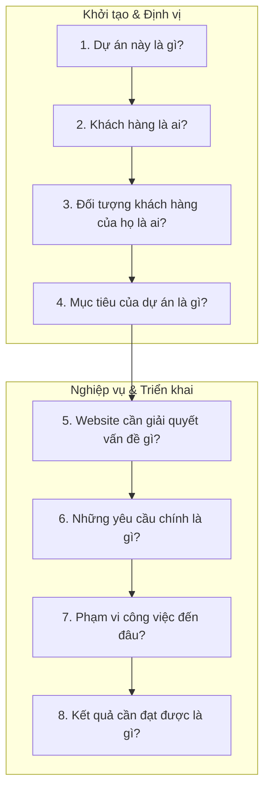

# TÀI LIỆU BRIEF DỰ ÁN (PROJECT BRIEF)
## HỆ THỐNG QUẢN LÝ DỊCH VỤ CHO THUÊ XE MÁY & Ô TÔ TỰ LÁI (DRIVERENT)

* **Tên dự án:** DriveRent - Smart Car & Motorbike Rental Management System
* **Mã dự án:** `DRV-RENT-2026`
* **Kho mã nguồn (GitHub):** [https://github.com/DinhTuanHai-TBD/QuanLyDatXe_DriveRent](https://github.com/DinhTuanHai-TBD/QuanLyDatXe_DriveRent)
* **Phiên bản:** v1.0.0 (Production Ready Prototype)
* **Ngày cập nhật:** 13/10/2026

---

> [!NOTE]
> **Cấu trúc tài liệu Brief:** Được xây dựng chuẩn theo phương pháp tiếp cận *"Hiểu đúng bài toán trước khi làm"* – trả lời đầy đủ và chi tiết 8 câu hỏi cốt lõi của một dự án công nghệ.



---

## 1. DỰ ÁN NÀY LÀ GÌ?

**DriveRent** là **Hệ thống phần mềm quản lý và vận hành dịch vụ cho thuê xe máy & ô tô tự lái toàn diện (All-in-one Rental Platform)**, tích hợp đồng bộ 2 phân hệ cốt lõi trên một nền tảng duy nhất:

1. **Cổng Khách hàng (Customer Booking Portal):**
   * Website trực tuyến hiện đại dành cho du khách tìm kiếm, tham khảo thông số, kiểm tra giá thuê theo giờ/ngày và đặt cọc giữ chỗ trực tuyến.
   * Ứng dụng ngôn ngữ thiết kế **Liquid Glass (kính mờ trong suốt cao cấp)**, hiệu ứng xe chạy vào bãi gara LED 3D sống động, thanh điều hướng taskbar chuyển đổi trạng thái mượt mà theo vị trí cuộn trang.
2. **Hệ thống Quản trị & Điều hành Nội bộ (Admin Operations System):**
   * Bảng điều khiển dành riêng cho chủ nhà xe, nhân viên lễ tân, kế toán và đội ngũ thợ kỹ thuật.
   * Giám sát đội xe trực quan theo thời gian thực, số hóa quy trình lập hợp đồng trong 2 phút, quản lý biên bản bàn giao - thu hồi xe kèm ảnh chụp hiện trạng, tự động quyết toán phân định tiền cọc và quản lý lịch bảo trì, nhắc thay nhớt định kỳ.

---

## 2. KHÁCH HÀNG LÀ AI?

Khách hàng trực tiếp của dự án (Chủ sở hữu hệ thống / Bên đặt hàng) là:

* **Chủ doanh nghiệp, chuỗi cửa hàng và cơ sở kinh doanh dịch vụ cho thuê phương tiện tự lái:**
  * Quy mô từ vừa đến nhỏ (từ 15 đến 80+ xe hỗn hợp cả ô tô và xe máy).
  * Tập trung tại các thành phố du lịch trọng điểm của Việt Nam: Đà Nẵng, Nha Trang, Phú Quốc, Đà Lạt, Quy Nhơn, Vũng Tàu, Hà Nội, TP.HCM,...
* **Đội ngũ vận hành nội bộ của nhà xe:**
  * **Quản lý / Chủ cửa hàng:** Cần giám sát tổng thể tình hình kinh doanh, doanh thu, dòng tiền cọc đang nắm giữ và hiệu suất khai thác đội xe.
  * **Nhân viên Lễ tân / Tiếp đón (Front Desk / Sales):** Cần thao tác tra cứu xe trống nhanh chóng, làm thủ tục hợp đồng, bàn giao xe cho khách mà không tốn thời gian ghi chép thủ công.
  * **Kỹ thuật viên / Thợ bảo dưỡng (Technician):** Cần theo dõi số Km lăn bánh của từng xe để thay dầu nhớt, kiểm tra má phanh, lốp xe đúng định kỳ.

---

## 3. ĐỐI TƯỢNG KHÁCH HÀNG CỦA HỌ LÀ AI?

Đối tượng khách hàng cuối (End-users) mà các nhà xe phục vụ bao gồm:

* **Khách du lịch cá nhân & Nhóm bạn trẻ:**
  * Nhu cầu thuê xe máy (xe tay ga, xe số) hoặc ô tô cỡ nhỏ (Sedan hạng B) để tự do phượt, khám phá danh lam thắng cảnh và ẩm thực địa phương.
  * Ưa chuộng công nghệ: Thích xem ảnh thật của xe, bảng giá minh bạch, đặt cọc giữ xe nhanh qua mã QR chuyển khoản ngân hàng.
* **Khách du lịch gia đình:**
  * Nhu cầu thuê ô tô 7 chỗ (MPV, SUV như Mitsubishi Xpander, Toyota Innova,...) rộng rãi, an toàn, có điều hòa tốt và khoang hành lý lớn.
  * Đòi hỏi cao về tính an toàn, bảo dưỡng định kỳ và hợp đồng pháp lý minh bạch.
* **Chuyên gia & Khách công tác ngắn ngày:**
  * Cần thuê xe tự lái theo ngày hoặc theo giờ để di chuyển giữa sân bay, khách sạn và các địa điểm làm việc.
* **Người dân địa phương:**
  * Có nhu cầu thuê xe phục vụ đám cưới, về quê dịp lễ tết hoặc phương tiện cá nhân đang bảo hành/sửa chữa.

---

## 4. MỤC TIÊU CỦA DỰ ÁN LÀ GÌ?

Dự án DriveRent hướng tới các mục tiêu chiến lược:

1. **Số hóa 100% quy trình vận hành:** Xóa bỏ hoàn toàn việc ghi chép sổ sách thủ công, bảng tính Excel rời rạc hoặc trao đổi qua tin nhắn Zalo dễ thất lạc.
2. **Rút ngắn thời gian xử lý thủ tục:** Giảm thời gian lập hợp đồng và bàn giao nhận xe từ 15–20 phút xuống còn **dưới 2–3 phút** nhờ Wizard 4 bước và biên bản số hóa.
3. **Minh bạch tài chính & Bảo vệ tài sản:** Phân tách rõ ràng giữa tiền cọc cách ly (Security Deposit) và doanh thu dịch vụ thực tế; lưu trữ ảnh chụp hiện trạng xe lúc giao/nhận để loại trừ 100% nguy cơ tranh chấp trầy xước.
4. **Nâng cao hiệu suất khai thác xe:** Giám sát trạng thái đội xe theo thời gian thực (Sẵn sàng / Đang thuê / Bảo dưỡng) để hạn chế tối đa tình trạng trùng lịch (overbooking) hoặc để xe trống lãng phí.
5. **Duy trì an toàn & Kéo dài tuổi thọ phương tiện:** Cảnh báo tự động lịch thay dầu nhớt và kiểm tra định kỳ theo định mức Km lăn bánh và số ngày thực tế.
6. **Đột phá trải nghiệm khách hàng:** Cung cấp giao diện website phong cách Liquid Glass sang trọng, thao tác mượt mà, định vị thương hiệu nhà xe đẳng cấp trong mắt khách du lịch.

---

## 5. WEBSITE CẦN GIẢI QUYẾT VẤN ĐỀ GÌ?

Website DriveRent được xây dựng để giải quyết triệt để **4 nỗi đau (Pain Points) lớn nhất** trong ngành cho thuê xe:

### 5.1. Vấn đề 1: Mất kiểm soát trạng thái phương tiện thời gian thực
* *Thực trạng:* Quản lý bằng sổ tay hoặc trí nhớ khiến nhân viên không biết chính xác xe nào đang đỗ tại bãi, xe nào đang cho thuê, xe nào sắp đến giờ trả và xe nào đang hỏng hóc.
* *Hậu quả:* Nhận cọc của khách nhưng không có xe giao (trùng lịch / overbooking), hoặc khách đến hỏi nhưng nhân viên tưởng hết xe nên từ chối.
* *Giải pháp DriveRent:* **Sơ đồ trạng thái xe trực quan (Visual Fleet Board)** với 3 màu chuẩn nhận diện (🟢 Sẵn sàng, 🔵 Đang thuê, 🟠 Đang bảo dưỡng), lọc xe trống theo ngày giờ nhận/trả chỉ trong 1 click.

### 5.2. Vấn đề 2: Tranh chấp hư hỏng trầy xước & Thất lạc hồ sơ giấy tờ
* *Thực trạng:* Bàn giao xe chỉ nhìn bằng mắt thường, không chụp ảnh lưu trữ; giữ CMND/CCCD gốc dễ làm thất lạc hoặc gây phiền toái cho khách.
* *Hậu quả:* Khi trả xe phát hiện vết móp méo, trầy xước mới, hai bên cãi vã vì không có bằng chứng đối chiếu. Khi có phạt nguội vi phạm giao thông, nhà xe không tìm lại được thông tin người lái.
* *Giải pháp DriveRent:* **Biên bản bàn giao & thu hồi số hóa (Digital Handover/Return)** với checklist 6 hạng mục, lưu trữ trực tiếp ảnh chụp 4 góc xe và ảnh chụp 2 mặt CCCD, Giấy phép lái xe gốc.

### 5.3. Vấn đề 3: Tính toán chi phí thủ công & Nhập nhằng tiền cọc
* *Thực trạng:* Khách thuê linh hoạt (trả trễ vài tiếng, thiếu vạch xăng, thuê thêm nón bảo hiểm, giao xe tận nơi). Tính nhẩm thủ công dễ sai lệch.
* *Hậu quả:* Kế toán nhầm lẫn tiền cọc của khách vào doanh thu, dẫn đến cãi cọ gay gắt lúc thanh lý hợp đồng và hoàn tiền cọc.
* *Giải pháp DriveRent:* **Quyết toán tự động & Phân định tiền cọc (Auto-Billing & Deposit Isolation)**. Tiền cọc được lưu trữ ở tài khoản ký quỹ riêng, hệ thống tự động bù trừ vào tiền thuê thực tế hoặc hoàn trả 100% cọc qua VietQR.

### 5.4. Vấn đề 4: Bỏ quên lịch thay nhớt và bảo dưỡng định kỳ
* *Thực trạng:* Xe cho thuê chạy cường độ cao liên tục, không ai nhớ xe nào đã chạy bao nhiêu km từ lần thay dầu gần nhất.
* *Hậu quả:* Động cơ xe máy bó máy, ô tô quá nhiệt hoặc mòn phanh gây nguy hiểm tính mạng cho du khách khi đi đường đèo dốc, chi phí đại tu tốn kém hàng chục triệu đồng.
* *Giải pháp DriveRent:* **Hệ thống cảnh báo kép (Dual-trigger Alerts)** tự động nhắc thay nhớt khi xe đạt mốc Km (3.000 km với xe máy, 5.000 km với ô tô) hoặc chạm mốc ngày quy định.

---

## 6. NHỮNG YÊU CẦU CHÍNH LÀ GÌ?

### 6.1. Yêu cầu Phân hệ Khách hàng (Customer Portal)
* **Giao diện Liquid Glass chuẩn mực:** Kính mờ trong suốt (`backdrop-blur-2xl`), viền sáng bóng, đổ bóng mờ sang trọng phủ khắp toàn bộ trang web.
* **Thanh Taskbar thông minh (Sticky & Adaptive):** Cố định ở đầu màn hình khi cuộn trang; hiển thị dạng kính trong suốt nhìn thấu gara khi ở đầu trang và chuyển sang màu trắng thanh lịch khi cuộn xuống.
* **Hero Showroom Banner:** Nền gara vòm LED tràn viền toàn màn hình (`100vw`); hiệu ứng xe lăn bánh tự động vào tâm bãi đỗ, chuyển đổi thông tin xe 2 bên và bên dưới dạng kính trong suốt.
* **Danh mục phương tiện & Bộ lọc:** Lọc xe theo loại (*Ô tô / Xe máy*), hãng xe, số chỗ, mức giá thuê theo giờ và theo ngày.
* **Đặt xe & Giữ cọc 10 phút:** Modal thanh toán quét mã VietQR tự động sinh nội dung chuyển khoản, đồng hồ đếm ngược 10 phút giữ xe.
* **Tra cứu lịch trình:** Khách hàng nhập số điện thoại để tra cứu hợp đồng và thông tin bàn giao xe.

### 6.2. Yêu cầu Phân hệ Quản trị Vận hành (Admin Operations)
* **Quản lý Đội xe (Fleet Management):** Sơ đồ thẻ lưới (Grid View) và bảng (Table View), hiển thị mức xăng (1-8 vạch), số ODO, biển số và trạng thái màu.
* **Lập Hợp đồng nhanh (Create Contract Wizard 4 bước):**
  * *Bước 1:* Chọn xe & thời gian (tự động kiểm tra xung đột trùng lịch).
  * *Bước 2:* Nhập/chọn khách hàng thân thiết.
  * *Bước 3:* Chụp và lưu trữ ảnh CCCD/GPLX gốc.
  * *Bước 4:* Thiết lập tiền cọc cách ly, phụ phí và giảm giá.
* **Biên bản Giao - Nhận xe số hóa (Handover/Return Modal):**
  * Checklist kiểm tra 6 hạng mục (Thân vỏ, lốp, đèn/còi, gương, xăng, phụ kiện).
  * Lưu ảnh chụp 4 góc xe, ghi nhận số ODO và vạch xăng thực tế.
  * Nhập phí bồi thường hư hại (Damage Fee) nếu phát sinh va quẹt.
* **Quyết toán & Thanh lý hợp đồng (Settlement Modal):**
  * Tự động tính thời gian thuê thực tế theo đơn giá (làm tròn chuẩn).
  * Lựa chọn: Khấu trừ cọc vào cước thuê hoặc Hoàn cọc 100% riêng biệt.
* **Quản lý Bảo trì & Nhắc thay nhớt (Maintenance View):**
  * Theo dõi mốc Km và ngày đến hạn bảo dưỡng.
  * Chuyển trạng thái xe sang "Đang bảo dưỡng" (ngăn không cho khách thuê).
* **Bản in hợp đồng A4 (Print Contract Modal):** Mẫu in chuẩn khổ giấy A4 có đầy đủ Quốc hiệu Tiêu ngữ, điều khoản pháp lý và chữ ký xác nhận 2 bên.

---

## 7. PHẠM VI CÔNG VIỆC ĐẾN ĐÂU? (SCOPE OF WORK)

### 7.1. Trong phạm vi (In-Scope - Đã hoàn thành):
* **Frontend Web Application:** Xây dựng toàn bộ giao diện responsive tương thích hoàn hảo từ Mobile (375px), Tablet (768px) đến Desktop/Màn hình lớn (1920px).
* **Thiết kế UI/UX & Liquid Glass System:** Hoàn thiện trọn vẹn bộ style Liquid Glass xuyên suốt toàn bộ ứng dụng (Customer Portal và Admin Portal).
* **Business Logic & State Management:** Xây dựng toàn bộ logic nghiệp vụ (tính giờ, kiểm tra trùng lịch, khấu trừ cọc, cảnh báo ODO, kiểm tra biên bản) trên React Context API với cơ sở dữ liệu quan hệ mô phỏng hoàn chỉnh.
* **Seed Data thực tế:** Cung cấp sẵn dữ liệu mẫu gồm 12 phương tiện (Toyota Vios, Mitsubishi Xpander, Honda Vision, AirBlade,...), khách hàng mẫu, hợp đồng mẫu và lịch bảo dưỡng thực tế.
* **Bản in hợp đồng pháp lý A4 & Quét mã VietQR:** Tích hợp sẵn mẫu in A4 chuẩn và cổng thanh toán QR code giả lập.

### 7.2. Ngoài phạm vi hiện tại (Out-of-Scope - Kế hoạch mở rộng):
* **Cơ sở dữ liệu đám mây (Cloud Database):** Kết nối backend phân tán (PostgreSQL / Supabase / MongoDB) thay cho State cục bộ.
* **Lưu trữ ảnh đám mây (Cloud Object Storage):** Đẩy ảnh CCCD và ảnh hiện trạng xe lên AWS S3 hoặc Cloudinary.
* **Thiết bị phần cứng IoT & GPS:** Lắp đặt hộp đen GPS trên xe để tự động đọc số ODO và vị trí xe theo thời gian thực về hệ thống.
* **Tích hợp eKYC & Webhook ngân hàng:** Tự động nhận dạng ký tự CCCD (OCR) và tự động xác nhận tiền cọc khi tiền vào tài khoản ngân hàng.

---

## 8. KẾT QUẢ CẦN ĐẠT ĐƯỢC LÀ GÌ? (DELIVERABLES & KPIS)

### 8.1. Sản phẩm bàn giao cụ thể (Deliverables):
1. **Kho mã nguồn hoàn chỉnh (Source Code Repository):**
   * Được quản lý trên GitHub: [QuanLyDatXe_DriveRent](https://github.com/DinhTuanHai-TBD/QuanLyDatXe_DriveRent).
   * Mã nguồn sạch, viết bằng TypeScript 100%, cấu trúc module phân tách rõ ràng, chạy lệnh `npm run build` thành công không có bất kỳ lỗi nào.
2. **Hệ thống ứng dụng chạy thực tế (Production-ready Prototype):**
   * Hoạt động ổn định, tốc độ phản hồi dưới 100ms trên môi trường Vite 8.
   * Chuyển đổi linh hoạt giữa giao diện Khách hàng và Quản trị viên chỉ với một thao tác.
3. **Bộ tài liệu kỹ thuật & Hướng dẫn vận hành:**
   * File `PROJECT_BRIEF.md` chuẩn hóa theo 8 câu hỏi cốt lõi.
   * File `README.md` hướng dẫn cài đặt và triển khai hệ thống chi tiết.

### 8.2. Tiêu chí thành công & Giá trị đạt được (Success Criteria & KPIs):
* **Hiệu suất vận hành:** Rút ngắn **85% thời gian** xử lý thủ tục giấy tờ hợp đồng (từ 15 phút xuống dưới 2 phút).
* **Độ chính xác tài chính:** Giảm **100% tình trạng thất thoát hoặc nhầm lẫn tiền cọc** giữa khách hàng và nhà xe nhờ cơ chế quyết toán phân định minh bạch.
* **Bảo vệ tài sản phương tiện:** Đảm bảo **100% lượt thuê có biên bản kiểm tra hình ảnh hiện trạng** và **100% phương tiện được cảnh báo bảo dưỡng đúng mốc Km ODO**.
* **Đẳng cấp thương hiệu:** Giao diện Liquid Glass chuẩn quốc tế tạo ấn tượng chuyên nghiệp vượt trội so với các cơ sở cho thuê xe truyền thống trên thị trường.

---

## PHỤ LỤC: CÔNG NGHỆ & HƯỚNG DẪN CÀI ĐẶT

### Tech Stack:
* **Core:** React 19 + TypeScript + Vite 8
* **Styling:** Tailwind CSS v4 + Motion (Framer Motion v12) + Lucide Icons
* **State Management:** React Context API (quan hệ dữ liệu đa thực thể `Vehicles`, `Customers`, `Contracts`, `Maintenance`)

### Lệnh cài đặt & Chạy:
```bash
# Clone repository
git clone https://github.com/DinhTuanHai-TBD/QuanLyDatXe_DriveRent.git
cd QuanLyDatXe_DriveRent

# Cài đặt thư viện
npm install

# Khởi chạy máy chủ phát triển
npm run dev
```
